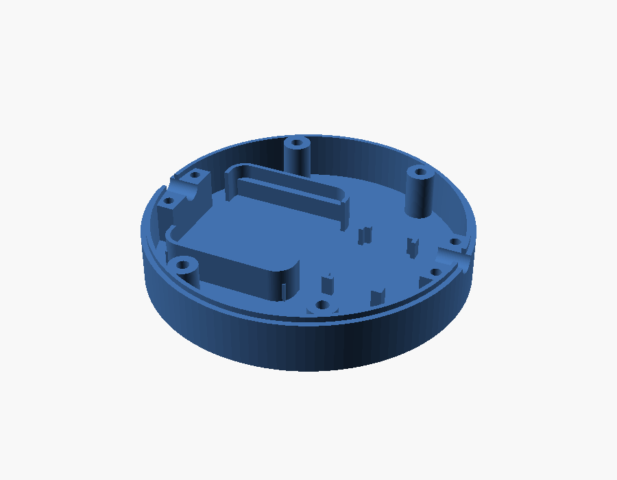
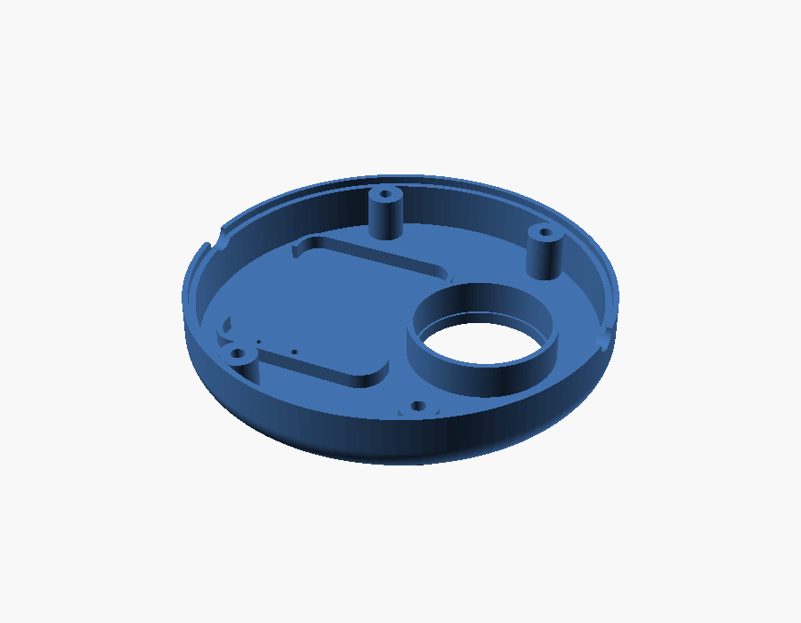
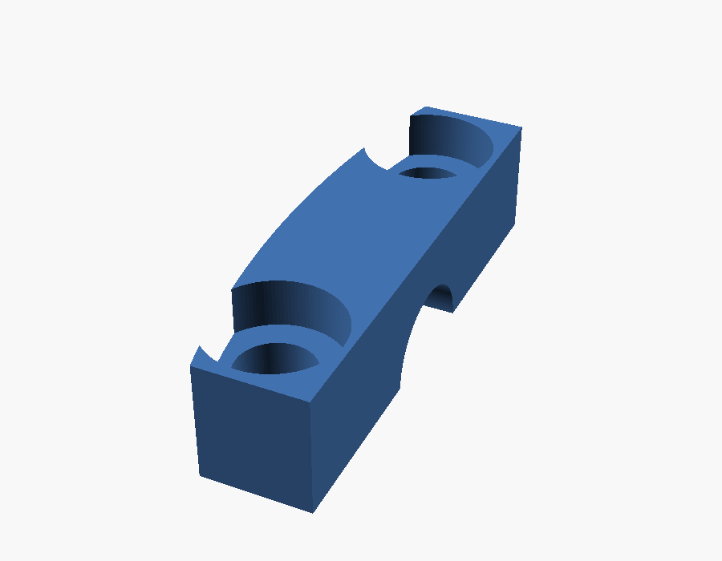
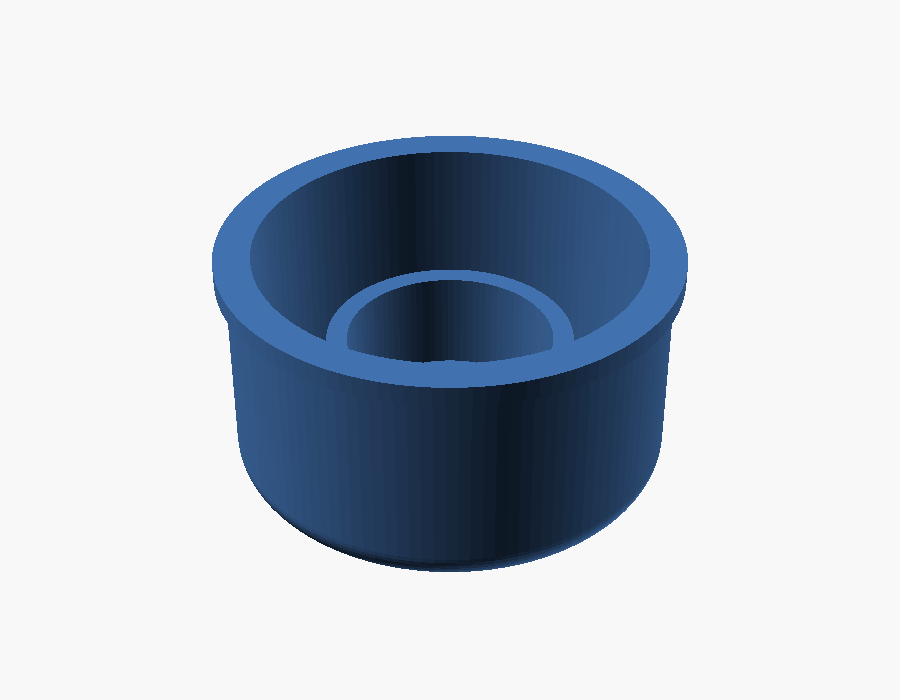
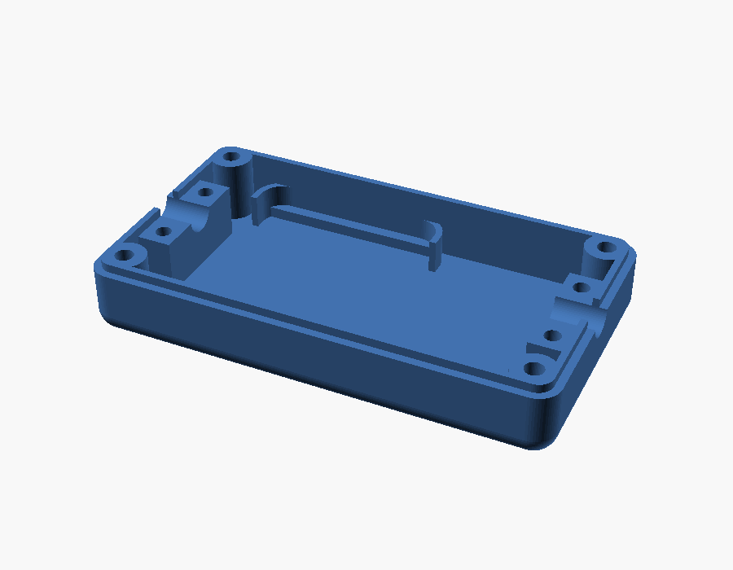
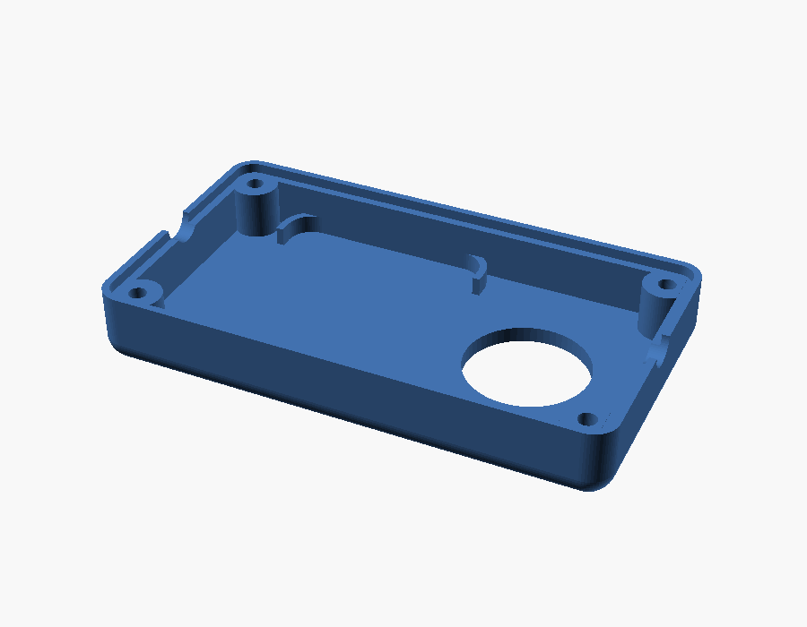
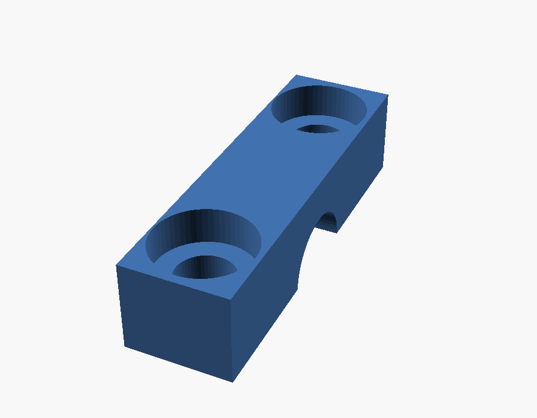

# scad-models

<!-- GENERATED by scripts/build-stl.mjs – do not edit. Edit src/<model>/README.md and the changelog in the .scad header instead. -->

Parametric OpenSCAD models for 3D printing. Every model lives in `src/<model>/` and is built into STL files, a zip and a source snapshot per version under `dist/<model>/`.

| Model | Description | Version | Parts |
|---|---|---|---|
| [zbminir2-cord-floor-switch](#zbminir2-cord-floor-switch) | Round two-part enclosure for a Sonoff ZBMINIR2 module with a cable passage and clamp on both ends, plus a floor-switch button with a spring-loaded cap. | 1.0.0 | `base`, `lid`, `clamp`, `cap` |
| [zbminir2-cord-switch](#zbminir2-cord-switch) | Rectangular two-part enclosure for a Sonoff ZBMINIR2 module with a cable passage and clamp on both short sides. Superseded by the round variant `zbminir2-cord-floor-switch`. | 1.0.0 | `base`, `lid`, `clamp` |

## zbminir2-cord-floor-switch

Round two-part enclosure for a Sonoff ZBMINIR2 module with a cable passage and clamp on both ends, plus a floor-switch button with a spring-loaded cap.

   

- Source: [`src/zbminir2-cord-floor-switch/zbminir2-cord-floor-switch.scad`](src/zbminir2-cord-floor-switch/zbminir2-cord-floor-switch.scad)
- Documentation: [`src/zbminir2-cord-floor-switch/README.md`](src/zbminir2-cord-floor-switch/README.md)
- Current version: **1.0.0**
- Parts: `base`, `lid`, `clamp`, `cap`

| Version | Download (zip of all STL) | Source | Changes |
|---|---|---|---|
| 1.0.0 | [zbminir2-cord-floor-switch-v1.0.0.zip](dist/zbminir2-cord-floor-switch/v1.0.0/zbminir2-cord-floor-switch-v1.0.0.zip) | [zbminir2-cord-floor-switch-v1.0.0.scad](dist/zbminir2-cord-floor-switch/v1.0.0/zbminir2-cord-floor-switch-v1.0.0.scad) | Initial versioned release: round two-part enclosure (base + lid) with cable clamps, ZBMINIR frames and ribs that grow with inner_z, floor switch feet, guide sleeve and button cap |

## zbminir2-cord-switch

Rectangular two-part enclosure for a Sonoff ZBMINIR2 module with a cable passage and clamp on both short sides. Superseded by the round variant `zbminir2-cord-floor-switch`.

  

- Source: [`src/zbminir2-cord-switch/zbminir2-cord-switch.scad`](src/zbminir2-cord-switch/zbminir2-cord-switch.scad)
- Documentation: [`src/zbminir2-cord-switch/README.md`](src/zbminir2-cord-switch/README.md)
- Current version: **1.0.0**
- Parts: `base`, `lid`, `clamp`

| Version | Download (zip of all STL) | Source | Changes |
|---|---|---|---|
| 1.0.0 | [zbminir2-cord-switch-v1.0.0.zip](dist/zbminir2-cord-switch/v1.0.0/zbminir2-cord-switch-v1.0.0.zip) | [zbminir2-cord-switch-v1.0.0.scad](dist/zbminir2-cord-switch/v1.0.0/zbminir2-cord-switch-v1.0.0.scad) | Initial versioned release: rectangular two-part enclosure; "base" is the lower half and "lid" the upper half |

## License

Copyright (c) 2026 Jan Kropáč (hondzik)

- **Models** (`src/**/*.scad`), the **generated files** in `dist/` (STL, zip, source snapshots, images) and the **documentation** are licensed under [**CC BY 4.0**](LICENSE) – you may share and adapt them, also commercially, as long as you give appropriate credit and indicate changes.
- The **build tooling** (`scripts/`, `package.json`) is licensed under the [**MIT License**](LICENSE-CODE), because Creative Commons licenses are not recommended for software.

The enclosures hold mains-voltage devices – see the safety notes in the model documentation. Everything is provided as-is, without any warranty.
